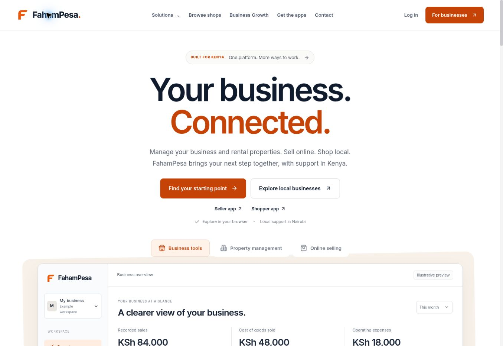
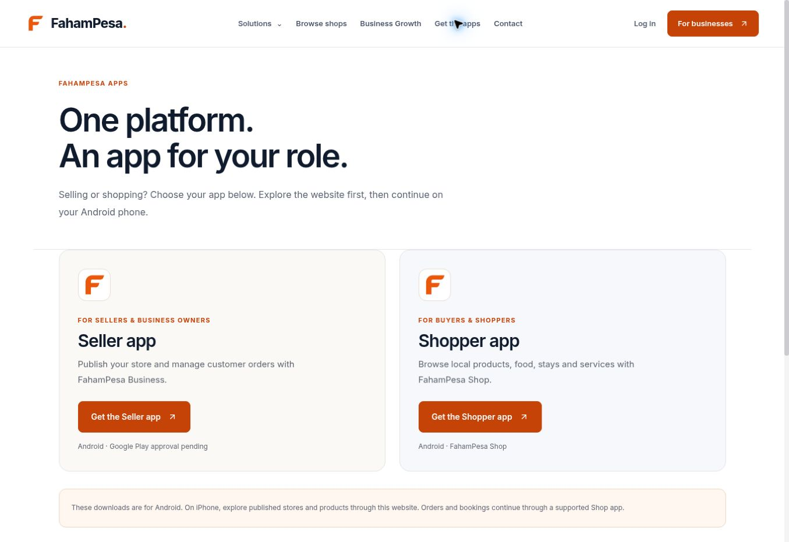
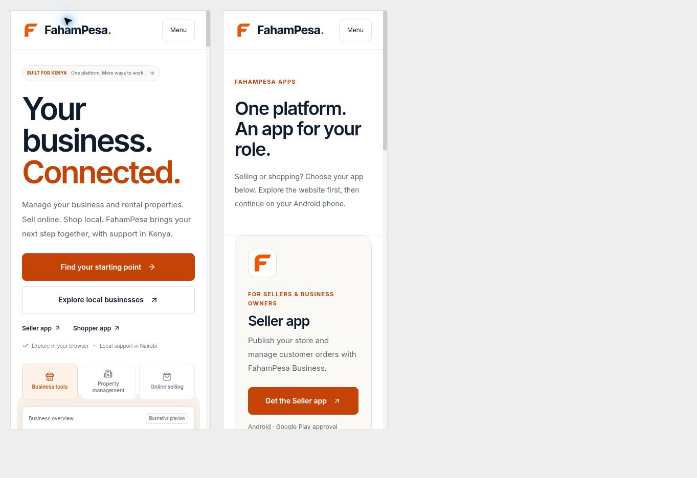

# New F logo website release

Date: 9 November 2026
Extends pending public release bde024ce5db291838f6fbad94dcbcd347af81424. Includes all preceding website improvements.

## Changes

- Converted the selected orange F concept into a compact flat vector master. Solid #EA580C, open counter, curved shoulder and angled arm ends. Removed the generated preview's surface shading.
- Added white-background PNG exports at 180, 192 and 512 pixels, plus a 16/32/48-pixel ICO. The vector master is 253 bytes and remains sharp in responsive headers.
- Updated shared header, footer, illustrative product tour, Seller/Shopper cards and individual app pages, shared store/product headers, app handoff card, and legacy website logo references.
- Header, footer, illustration and app-logo links point to /. Existing download buttons retain their Seller and Shopper destinations and availability labels.
- Updated organization logo metadata, browser favicon, Apple icon and generated social preview. Versioned asset URLs avoid retaining the old logo through image caches. Older image URLs also serve the new mark for compatibility.
- Added scripts/build-brand-icons.mjs to reproduce raster exports from the vector master with the project's existing Sharp installation.
- No Android package, Play Store listing, Google Business Profile image or separately deployed business application is changed by this website release.

## Verification

- Focused public TypeScript check passed.
- Next.js production build passed. Existing global legacy type/lint validation limitations remain.
- Production public HTTP regression passed, including metadata, routes, app package links, sitemap behavior and generated social image dimensions.
- Browser verified the Seller card F returns to the homepage. Header F from the Seller page returns to the homepage. Mobile 320-width header F returns from Apps to the homepage.
- Homepage at 390 and Apps at 320 have no horizontal overflow. Content widths: 382/382 and 312/312 including scrollbar.
- Desktop, app cards, mobile views and final generated share image visually reviewed.
- Source scan found no active reference to the old logo filenames or old blue SVG in application code. Compatibility files now contain the new F.
- git diff --check passed.

## Deployment

Stage this commit for fahampesa-public-web only. The user requested completing these changes before their Deploy click. Do not trigger deployment in this step. Verify Railway's sole pending change points to the final combined commit. Backend and business frontend remain unchanged.

## Evidence

