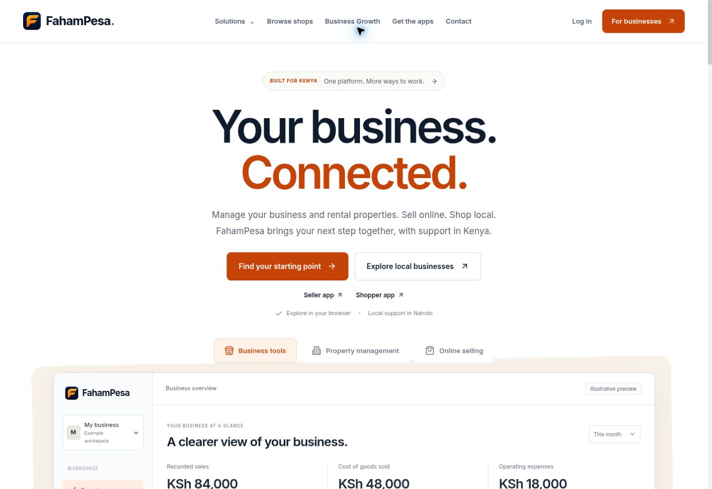
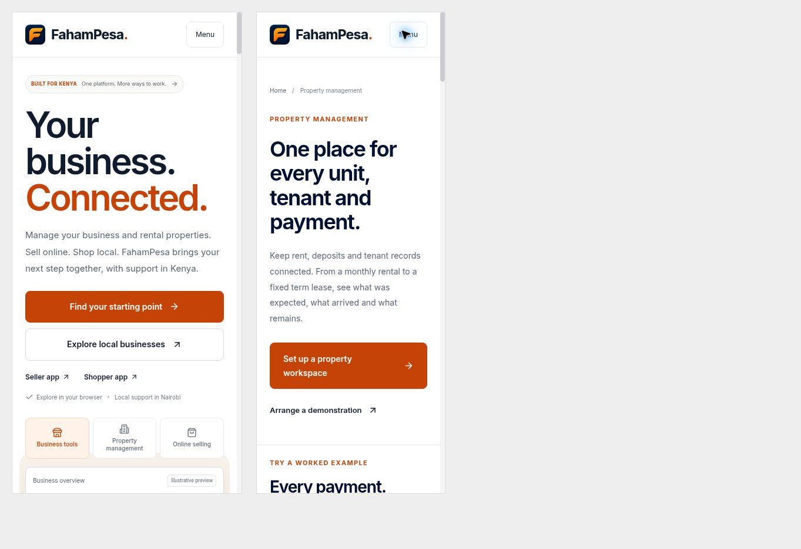

# Search and brand release audit

Date: 9 November 2026
Scope: public website, search metadata, social previews and Google Business Profile consistency.

## Result

Prepared website presentation: 9/10, a qualitative design judgment rather than a ranking guarantee. The original search screenshot was rated 6.5/10. The public Google result has not been rescored because this release is not deployed and Google has not recrawled it. A 10/10 claim would be unsupported.

Two review passes completed. The second pass corrected the old blue logo in the product illustration and replaced the share card's default font with the site's Inter font. The new content represents business tools, rental management, sellers and shoppers.

## Completed checks

1. Homepage title and description represent the broader platform.
2. Organization, WebSite, Open Graph and visible brand use FahamPesa consistently, with Fahampesa retained as a search alias.
3. Main audience links clearly identify business tools, property management, online selling and local shops.
4. Property, seller, shopper, industry and app page metadata use consistent brand naming and clearer titles.
5. The social card renders at 1200 by 630 pixels with the existing orange/navy logo and Inter typography.
6. A 192-pixel PNG favicon is declared alongside the existing compatibility icon.
7. Existing factual business contact details, verification codes and entity schema are preserved.
8. Illustrative financial figures are marked data-nosnippet. No invented customer reviews or business history were added.
9. Canonical routes, legal links, app availability and existing crawl/indexing behavior are preserved.
10. Desktop visual review and 390/320-width iframe checks completed. No horizontal overflow was observed. Keyboard activation opened the mobile menu and followed Property management to the correct page. Pointer interaction in the iframe harness was unreliable, so no native phone touch claim is made.

## Validation

- Focused public-page TypeScript check passed: npx tsc --noEmit -p tsconfig.shared-pages.json.
- Production build passed with a placeholder Stripe key for the existing build requirement.
- Production HTTP regression passed: node --test tests/growth-http.test.mjs. It checks broader homepage metadata, schema, favicon, sample exclusions, existing public routes, and PNG dimensions/content type.
- git diff --check passed.
- Whole application TypeScript validation is not claimed. Including the root layout's unrelated private auth/Firestore dependency graph exposed existing errors outside this public-page scope. Root metadata was extracted into a separately checked typed module.

## Google account work

The profile name correction to FahamPesa was submitted and read back as pending review. The saved description already describes the broader platform. The TikTok HTTPS URL was accepted. Google blocked the photo manager with an unusual-traffic verification page. No photo uploads, fabricated images, review requests, or messages were sent.

## Remaining work

- Add verified, current showroom/team/product photos through the business owner account when accessible. Do not substitute generated photos for real evidence.
- Deploy this exact source through the existing public Railway service.
- Inspect the live title, card and key paths after deployment, then monitor Google's recrawl. Google chooses displayed snippets, sitelinks and profile images.
- Check on a physical Android/iPhone device before claiming device-level touch verification or field performance scores.

## Evidence

